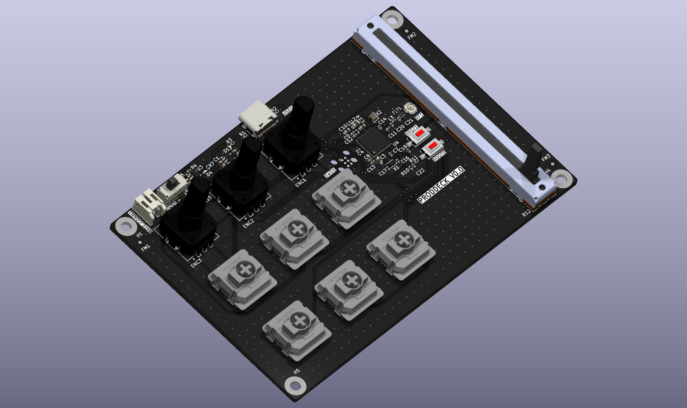
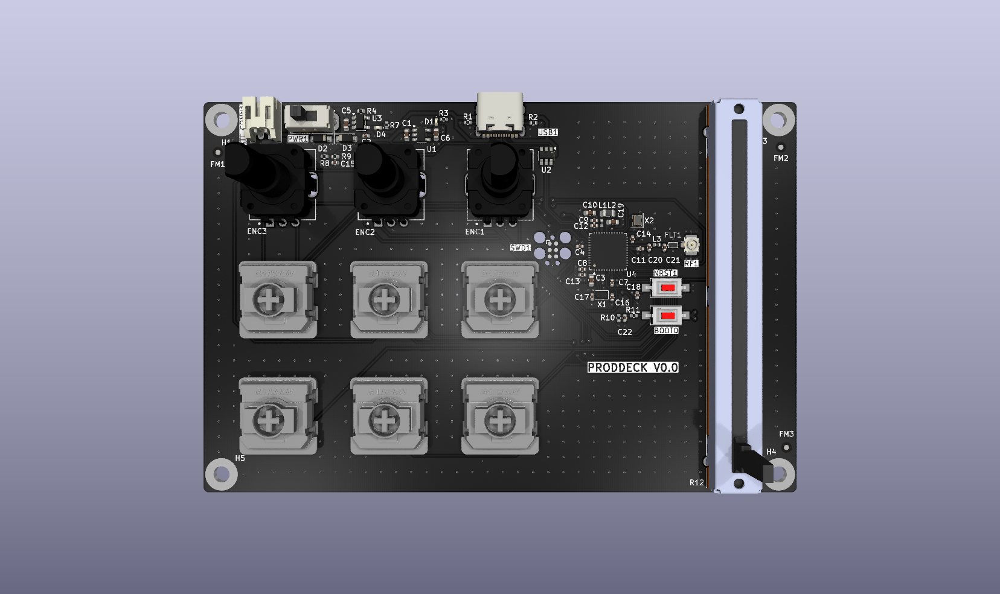
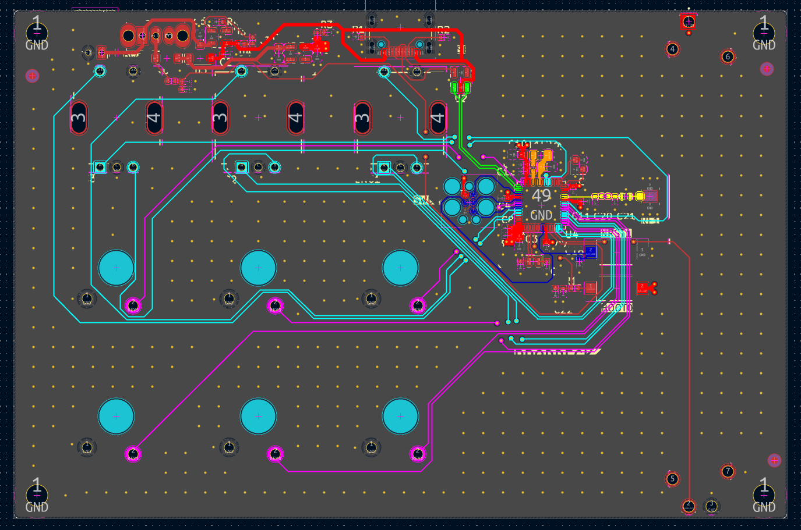

# ProdDeck

Custom PCB productivity deck — StreamDeck-style device with key switches, rotary encoders, and a slider. Targets editors, designers, and video editors.

A joint project with product design student **Aleksandra Elin** ([LinkedIn](https://www.linkedin.com/in/aleksandra-elin-6274052a9/)).

**Hardware:**
- 6x key switches — Gateron KS-33 (Low Profile 2.0)
- 3x rotary encoders with push button — Bourns PEC11R-4220F-S0024
- 1x slider (fader) — Bourns PTA6043-2015DPB103
- MCU — STM32WB55CGU6 (BLE + native USB)
- USB-C (wired HID + charging) and LiPo battery (wireless BLE HID)

## PCB

| 3D view (top) | Layout |
|---|---|
|  |  |

## Repository Layout

| Folder | Contents |
|---|---|
| `KiCAD/ProdDeck/` | Schematic and PCB layout (KiCad 10), project libraries in `libs/`, fabrication outputs in `fab/` |
| `firmware/` | MCU firmware (ZMK) |
| `app/` | Desktop configurator — maps keys/dials/slider to shortcuts and app profiles |
| `enclosure/` | 3D mechanical files for chassis/panel |
| `Docs/` | Component specs, schematic plan, datasheet notes |

## Status

| Area | Status |
|---|---|
| Component selection | Done |
| Schematic | Done |
| PCB layout | Done — 4-layer, 117 x 77 mm, fully routed, DRC clean |
| Fabrication outputs | Generated — Gerbers, drill, BOM and JLCPCB CPL in `KiCAD/ProdDeck/fab/` |
| Firmware | Not started — framework chosen (ZMK); board definition still to be written |
| Configurator app | Not started — stack not yet decided (Tauri vs Electron) |
| Enclosure | Not started — CAD tool not yet decided |
